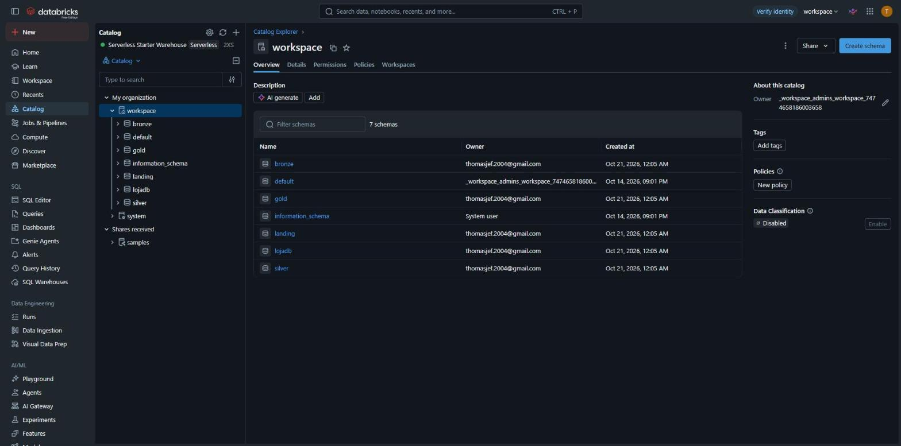
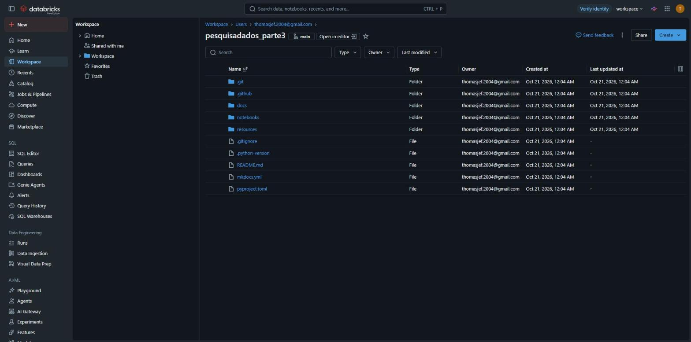
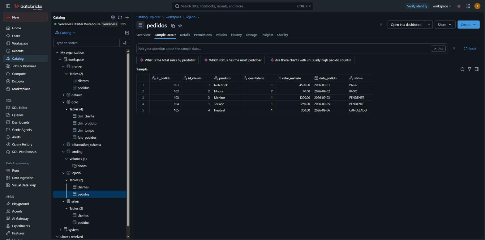

# Ambiente Databricks

## Databricks Free Edition
O **Databricks** é uma plataforma de dados em nuvem no modelo **PaaS** (*Platform as a Service*): o grupo não instala nem administra servidores, Spark ou armazenamento, apenas usa os recursos prontos da plataforma. A **Free Edition** é a versão gratuita, com computação **serverless** (o cluster é criado e desligado automaticamente a cada execução).

Nos trabalhos 1 e 2 o pipeline rodava localmente, com Docker (SQL Server e MinIO), Spark e Delta Lake instalados na máquina. Neste trabalho **tudo fica dentro do Databricks**: banco de origem, arquivos brutos, tabelas Delta, modelagem dimensional e orquestração.

| Trabalho 2 (local) | Trabalho 3 (Databricks) |
|---|---|
| SQL Server em Docker (`LojaDB`) | Schema `workspace.lojadb` |
| Bucket `landing-zone` no MinIO | Volume `workspace.landing.dados` |
| Bucket `bronze` no MinIO | Schema `workspace.bronze` |
| — | Schema `workspace.silver` |
| — | Schema `workspace.gold` |
| Execução manual dos notebooks no JupyterLab | Job em **Jobs & Pipelines** |

## Unity Catalog
O **Unity Catalog** é a camada de governança do Databricks e organiza os objetos em três níveis: `catalogo.schema.objeto`. Todo o trabalho usa o catálogo padrão da Free Edition, chamado `workspace`.

- **Schema (database)**: agrupa tabelas e volumes de uma camada (`bronze`, `silver`, `gold`...).
- **Volume**: área de armazenamento de **arquivos** (CSV, JSON...) dentro de um schema, acessada pelo caminho `/Volumes/catalogo/schema/volume`.
- **Tabela MANAGED (gerenciada)**: o Databricks controla os metadados **e** os arquivos físicos; ao apagar a tabela, os dados também são apagados. Todas as tabelas deste trabalho são gerenciadas (gravadas com `saveAsTable`, sem `LOCATION`).



## Git folder
O repositório do GitHub foi importado no Databricks como **Git folder** (*Workspace → Create → Git folder*). Assim os notebooks executados são exatamente os versionados no GitHub, e alterações são sincronizadas com *Pull*.



## Notebook 001 – Preparando o ambiente
Cria todos os objetos usados pelo pipeline:

```sql
CREATE SCHEMA IF NOT EXISTS workspace.lojadb
COMMENT 'Schema/Database de origem (banco relacional LojaDB)';

CREATE SCHEMA IF NOT EXISTS workspace.landing
COMMENT 'Schema/Database para dados brutos (landing)';

CREATE VOLUME IF NOT EXISTS workspace.landing.dados
COMMENT 'Volume para dados brutos criados no schema/database landing';

CREATE SCHEMA IF NOT EXISTS workspace.bronze
COMMENT 'Schema/Database para dados bronze (delta)';

CREATE SCHEMA IF NOT EXISTS workspace.silver
COMMENT 'Schema/Database para dados silver (delta)';

CREATE SCHEMA IF NOT EXISTS workspace.gold
COMMENT 'Schema/Database para dados gold (delta) - modelagem dimensional';
```

Em seguida cria e popula as tabelas `clientes` e `pedidos` do banco de origem `lojadb`, com o mesmo DDL e os mesmos dados dos trabalhos 1 e 2 (veja a página de contextualização).



## Notebook 006 – Destruindo o ambiente
Apaga todos os schemas com `DROP SCHEMA ... CASCADE` (tabelas e volume juntos) e confirma com `SHOW SCHEMAS IN workspace`. Serve para recomeçar do zero e **não** faz parte do Job.
