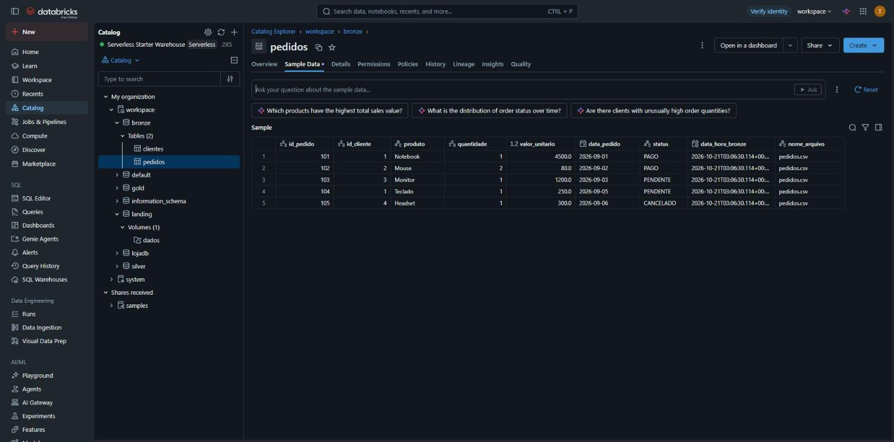

# 2. Ingestão → BRONZE

Notebook: `003_landing_para_bronze`

## O que é a camada bronze
A **bronze** guarda os dados **brutos (raw)**, sem nenhuma regra de negócio, mas já no formato **Delta Lake**. Em relação aos CSVs da landing, o Delta acrescenta transações ACID, histórico de versões (*time travel*) e schema registrado no catálogo, os mesmos recursos estudados nos trabalhos 1 e 2.

## Como funciona
1. `display(dbutils.fs.ls(...))` mostra os arquivos disponíveis no volume.
2. Um DataFrame é criado para cada CSV, com `header` e `inferSchema`.
3. Cada DataFrame recebe duas colunas de **metadado** para rastreabilidade:
    - `data_hora_bronze`: data e hora do processamento;
    - `nome_arquivo`: arquivo de origem na landing.
4. Os DataFrames são gravados com `saveAsTable`, gerando tabelas **MANAGED** no schema `bronze`.

```python
df_clientes = spark.read.option("inferSchema", "true").option("header", "true").csv(f"{caminho_landing}/clientes.csv")
df_pedidos  = spark.read.option("inferSchema", "true").option("header", "true").csv(f"{caminho_landing}/pedidos.csv")

df_clientes = df_clientes.withColumn("data_hora_bronze", current_timestamp()).withColumn("nome_arquivo", lit("clientes.csv"))
df_pedidos  = df_pedidos.withColumn("data_hora_bronze", current_timestamp()).withColumn("nome_arquivo", lit("pedidos.csv"))

df_clientes.write.format('delta').mode("overwrite").saveAsTable("bronze.clientes")
df_pedidos.write.format('delta').mode("overwrite").saveAsTable("bronze.pedidos")
```

No fim, `SHOW TABLES`, `DESCRIBE DETAIL` e `DESCRIBE EXTENDED` confirmam que as tabelas são Delta e do tipo **MANAGED**.

## Resultado – `bronze.pedidos`

| id_pedido | id_cliente | produto | quantidade | valor_unitario | data_pedido | status | nome_arquivo |
|---|---|---|---|---|---|---|---|
| 101 | 1 | Notebook | 1 | 4500.0 | 2026-09-01 | PAGO | pedidos.csv |
| 102 | 2 | Mouse | 2 | 80.0 | 2026-09-02 | PAGO | pedidos.csv |
| 103 | 3 | Monitor | 1 | 1200.0 | 2026-09-03 | PENDENTE | pedidos.csv |
| 104 | 1 | Teclado | 1 | 250.0 | 2026-09-05 | PENDENTE | pedidos.csv |
| 105 | 4 | Headset | 1 | 300.0 | 2026-09-06 | CANCELADO | pedidos.csv |

Note que `valor_unitario` chega como número decimal comum (`double`), pois o CSV não carrega o tipo original `DECIMAL(10,2)`. A correção do tipo é feita na silver.


