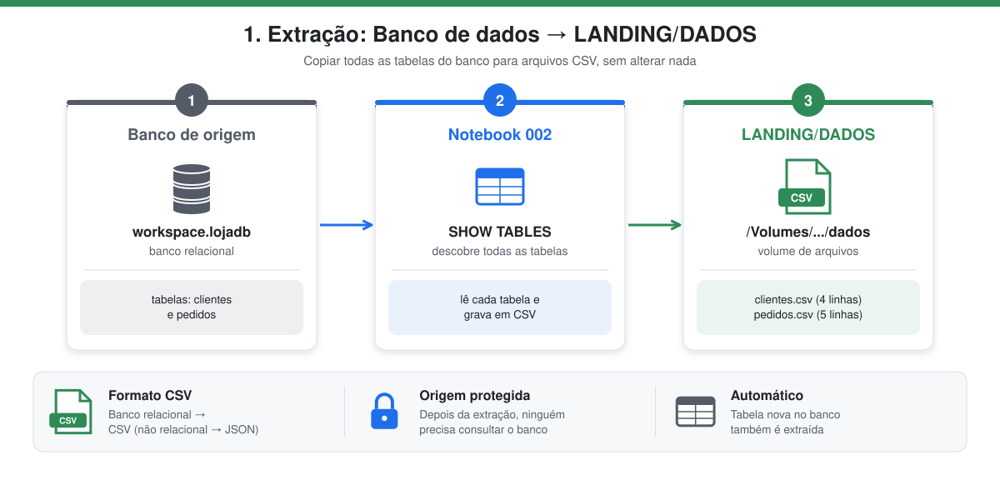
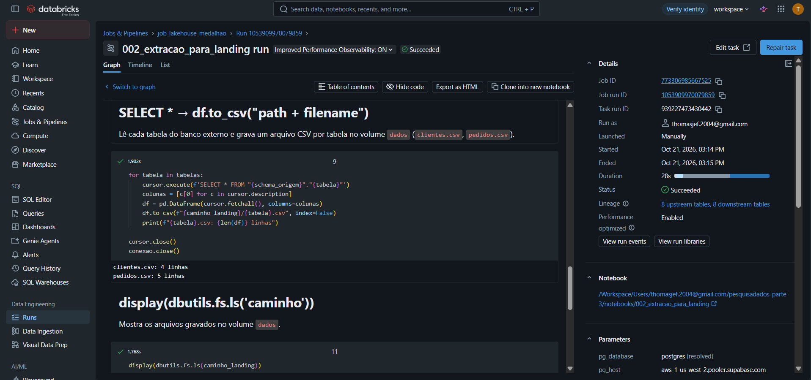

# 1. Extração → LANDING/DADOS

Notebook: `002_extracao_para_landing`



> **Em poucas palavras:** é como tirar uma fotocópia de cada tabela do banco e guardar numa pasta. Nada é alterado: o objetivo é ter uma cópia fiel dos dados, para que o banco da loja não precise ser consultado de novo.

| Condição | O que significa |
|---|---|
| Banco **externo** | A origem é um PostgreSQL na nuvem, fora do Databricks, acessado pela rede com `psycopg2`. |
| Extrair **todas** as tabelas | O notebook pergunta ao banco quais tabelas existem (`information_schema.tables`) e copia todas, sem lista fixa no código. |
| Gravar no schema **LANDING/DADOS** | Os arquivos ficam no volume `dados`, dentro do schema `landing`. |
| Formato **CSV** | Como o banco é relacional (tabelas com linhas e colunas), o formato pedido é CSV. |

## O que é a camada landing
A **landing** é a "zona de pouso": recebe a **cópia bruta** dos dados exatamente como saíram da origem, em arquivos. Ela isola o banco de origem do restante do pipeline: depois da extração, nenhuma camada precisa consultar o banco novamente.

Como a origem é um banco **relacional**, o formato exigido é **CSV** (para um banco não relacional seria JSON).

## Como funciona
1. Conecta no PostgreSQL externo com `psycopg2` (SSL), usando os parâmetros do Job (`pg_host`, `pg_user`, `pg_password`...). A senha não fica no código.
2. Lista **todas** as tabelas do schema `public` em `information_schema.tables`. Como a lista vem do próprio banco, uma tabela nova também seria extraída sem mudar o código.
3. Executa `SELECT *` em cada tabela e grava um arquivo `<tabela>.csv`, com cabeçalho, no volume `dados` do schema `landing`.

```python
import psycopg2
import pandas as pd

conexao = psycopg2.connect(host=..., port=5432, dbname="postgres",
                           user=..., password=..., sslmode="require")

with conexao.cursor() as cursor:
    cursor.execute("""SELECT table_name FROM information_schema.tables
                      WHERE table_schema = 'public' AND table_type = 'BASE TABLE'""")
    tabelas = [linha[0] for linha in cursor.fetchall()]

for tabela in tabelas:
    with conexao.cursor() as cursor:
        cursor.execute(f'SELECT * FROM "public"."{tabela}"')
        colunas = [c[0] for c in cursor.description]
        df = pd.DataFrame(cursor.fetchall(), columns=colunas)
    df.to_csv(f"/Volumes/workspace/landing/dados/{tabela}.csv", index=False)

conexao.close()
```

## Resultado

| Arquivo | Linhas | Tamanho |
|---|---|---|
| `/Volumes/workspace/landing/dados/clientes.csv` | 4 | 136 B |
| `/Volumes/workspace/landing/dados/pedidos.csv` | 5 | 282 B |


