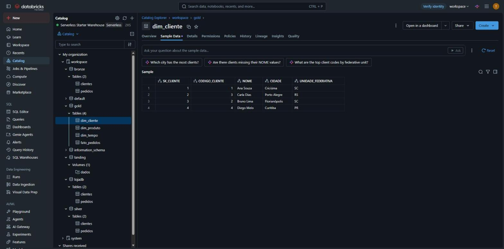
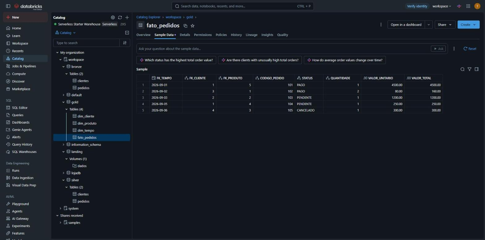

# 4. Modelagem dimensional → GOLD

Notebook: `005_silver_para_gold`

## O que é a camada gold
A **gold** contém os dados **prontos para consumo analítico** (BI, dashboards, relatórios), organizados segundo a **modelagem dimensional de Ralph Kimball**.

## Modelagem dimensional (Ralph Kimball)
Kimball propõe separar os dados em dois tipos de tabela, formando um **modelo estrela**:

- **Fato**: registra os eventos do negócio e as **métricas** numéricas (quantidade, valor). Aqui, cada pedido.
- **Dimensão**: descreve o contexto dos fatos, respondendo "quem, o quê, quando". Aqui, cliente, produto e tempo.

Outros conceitos aplicados:

- **Chave substituta (SK)**: cada dimensão tem uma chave própria (`SK_CLIENTE`, `SK_PRODUTO`), gerada pelo Delta com `bigint generated by default as identity`, independente da chave do sistema de origem.
- **SCD tipo 1**: as dimensões são carregadas com `MERGE`. Se um cliente mudar de cidade, o registro é **sobrescrito** (sem guardar histórico); se for novo, é **inserido**.
- **Dimensão tempo**: um calendário gerado com todos os dias de 2026, com ano, mês, nome do mês, dia e dia da semana.
- **Dimensão degenerada**: `CODIGO_PEDIDO` e `STATUS` ficam direto na fato, pois não têm outros atributos que justifiquem uma dimensão.

```
             dim_cliente
                  │
dim_produto ── fato_pedidos ── dim_tempo
```

| Tabela | Tipo | Chave | Colunas |
|---|---|---|---|
| `gold.dim_cliente` | Dimensão | `SK_CLIENTE` | CODIGO_CLIENTE, NOME, CIDADE, UNIDADE_FEDERATIVA |
| `gold.dim_produto` | Dimensão | `SK_PRODUTO` | PRODUTO |
| `gold.dim_tempo` | Dimensão | `Data` | Ano, Mes, NomeMes, Dia, NomeDiaSemana, NumeroDiaSemana |
| `gold.fato_pedidos` | Fato | — | FK_TEMPO, FK_CLIENTE, FK_PRODUTO, CODIGO_PEDIDO, STATUS, QUANTIDADE, VALOR_UNITARIO, VALOR_TOTAL |

## Carga das dimensões (MERGE / SCD1)

```sql
WITH cliente_relacional AS (
	SELECT codigo_cliente, nome, cidade, unidade_federativa
	  FROM clientes
)
MERGE INTO gold.dim_cliente AS d
USING cliente_relacional AS r
ON r.codigo_cliente = d.codigo_cliente
WHEN MATCHED AND (r.nome <> d.nome OR r.cidade <> d.cidade OR r.unidade_federativa <> d.unidade_federativa) THEN
	UPDATE SET nome = r.nome, cidade = r.cidade, unidade_federativa = r.unidade_federativa
WHEN NOT MATCHED THEN
	INSERT (codigo_cliente, nome, cidade, unidade_federativa)
	VALUES (r.codigo_cliente, r.nome, r.cidade, r.unidade_federativa)
```

## Carga da fato
A fato busca a chave substituta de cada dimensão pelo valor natural (código do cliente, nome do produto e data):

```sql
insert into gold.fato_pedidos
select dtem.data, dcli.sk_cliente, dpro.sk_produto,
       p.codigo_pedido, p.status, p.quantidade, p.valor_unitario, p.valor_total
from pedidos p
       inner join gold.dim_cliente dcli on p.codigo_cliente = dcli.codigo_cliente
       inner join gold.dim_produto dpro on p.produto = dpro.produto
       inner join gold.dim_tempo dtem   on p.data_pedido = dtem.data
```

## Resultado

**`gold.dim_cliente`**

| SK_CLIENTE | CODIGO_CLIENTE | NOME | CIDADE | UNIDADE_FEDERATIVA |
|---|---|---|---|---|
| 1 | 1 | Ana Souza | Criciúma | SC |
| 2 | 3 | Carla Dias | Porto Alegre | RS |
| 3 | 2 | Bruno Lima | Florianópolis | SC |
| 4 | 4 | Diego Melo | Curitiba | PR |

A `SK_CLIENTE` não acompanha o `CODIGO_CLIENTE`, e isso é esperado: a chave substituta é independente da chave da origem.



**`gold.dim_produto`**

| SK_PRODUTO | PRODUTO |
|---|---|
| 1 | Mouse |
| 2 | Monitor |
| 3 | Headset |
| 4 | Teclado |
| 5 | Notebook |

**`gold.dim_tempo`**: 365 linhas (todos os dias de 2026).

**`gold.fato_pedidos`**

| FK_TEMPO | FK_CLIENTE | FK_PRODUTO | CODIGO_PEDIDO | STATUS | QUANTIDADE | VALOR_TOTAL |
|---|---|---|---|---|---|---|
| 2026-09-01 | 1 | 5 | 101 | PAGO | 1 | 4500.00 |
| 2026-09-02 | 3 | 1 | 102 | PAGO | 2 | 160.00 |
| 2026-09-03 | 2 | 2 | 103 | PENDENTE | 1 | 1200.00 |
| 2026-09-05 | 1 | 4 | 104 | PENDENTE | 1 | 250.00 |
| 2026-09-06 | 4 | 3 | 105 | CANCELADO | 1 | 300.00 |



## Consulta no modelo estrela
Total vendido por UF e status, cruzando a fato com a dimensão cliente:

```sql
select dcli.unidade_federativa, f.status, sum(f.valor_total) as total_vendido
from gold.fato_pedidos f
       inner join gold.dim_cliente dcli on f.fk_cliente = dcli.sk_cliente
group by dcli.unidade_federativa, f.status
order by dcli.unidade_federativa, f.status
```

| UNIDADE_FEDERATIVA | STATUS | TOTAL_VENDIDO |
|---|---|---|
| PR | CANCELADO | 300.00 |
| RS | PENDENTE | 1200.00 |
| SC | PAGO | 4660.00 |
| SC | PENDENTE | 250.00 |
