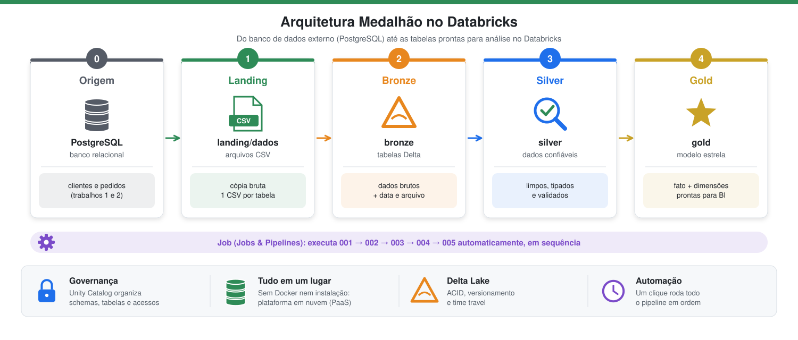

# Contextualização do Trabalho

Trabalho 3 da disciplina **Engenharia de Dados** (Engenharia de Software – 5ª fase – SATC), professor Jorge Luiz da Silva.
É um **complemento dos trabalhos 1 e 2** ([trabalho 1](https://thomasjefersonm.github.io/pesquisadados/) e [trabalho 2](https://thomasjefersonm.github.io/pesquisadados_parte2/)), em repositório separado.

## Objetivo
Construir um pipeline de dados no **Databricks Free Edition** implementando a **arquitetura medalhão** (experiência PaaS): **Landing → Bronze → Silver → Gold**, com todas as etapas encadeadas em um Job de **Jobs & Pipelines**.

## Cenário e conjunto de dados
Mesma loja virtual fictícia dos trabalhos 1 e 2. O banco relacional de origem `LojaDB` é um **PostgreSQL externo ao Databricks**, hospedado na nuvem (Supabase/Neon), criado pelo script `sql/lojadb_postgres.sql`. O Databricks só extrai os dados dele (notebook `002`):

| Tabela | Conteúdo |
|---|---|
| `clientes` | 4 clientes |
| `pedidos` | 5 pedidos |

### Modelo ER


Um cliente possui vários pedidos (relação 1:N por `id_cliente`).

### DDL (PostgreSQL)
```sql
CREATE TABLE clientes (
  id_cliente INT NOT NULL PRIMARY KEY,
  nome       VARCHAR(100) NOT NULL,
  cidade     VARCHAR(100),
  uf         CHAR(2)
);

CREATE TABLE pedidos (
  id_pedido      INT NOT NULL PRIMARY KEY,
  id_cliente     INT NOT NULL REFERENCES clientes (id_cliente),
  produto        VARCHAR(100) NOT NULL,
  quantidade     INT NOT NULL,
  valor_unitario DECIMAL(10,2) NOT NULL,
  data_pedido    DATE NOT NULL,
  status         VARCHAR(20) NOT NULL
);
```

## Arquitetura


> **Em poucas palavras:** os dados saem do banco da loja, passam por quatro "estações" (landing, bronze, silver e gold) e, a cada estação, ficam mais organizados e confiáveis, como um minério que é extraído, lavado, refinado e transformado em joia. Um **Job** liga todas as estações e faz o caminho inteiro com um clique.

| Camada | Pergunta que responde | Em linguagem simples |
|---|---|---|
| **Origem** (PostgreSQL externo) | De onde vêm os dados? | O banco de dados da loja, fora do Databricks, com clientes e pedidos. |
| **Landing** | Os dados foram copiados? | Uma "caixa de entrada" com a cópia dos dados em arquivos CSV, sem nenhuma alteração. |
| **Bronze** | Os dados estão guardados com segurança? | Os mesmos dados, agora em tabelas Delta, que registram o histórico e protegem contra gravações pela metade. |
| **Silver** | Os dados estão corretos? | Os dados revisados: nomes padronizados, tipos corrigidos, sem duplicados e sem valores inválidos. |
| **Gold** | Os dados estão prontos para análise? | Os dados organizados para responder perguntas de negócio, como "quanto vendemos por estado?". |

## Termos em linguagem simples

| Termo | Significado |
|---|---|
| **Databricks** | Plataforma na nuvem para trabalhar com dados; dispensa instalar programas no computador. |
| **Notebook** | Documento com blocos de código que são executados em ordem, com o resultado logo abaixo de cada bloco. |
| **Schema** | Uma "pasta" que agrupa tabelas de um mesmo assunto ou camada. |
| **Volume** | Uma "pasta" para guardar arquivos (como CSV) dentro do Databricks. |
| **CSV** | Arquivo de texto em formato de planilha: uma linha por registro e colunas separadas por vírgula. |
| **Delta Lake** | Formato de tabela que guarda o histórico de alterações e nunca deixa uma gravação pela metade. |
| **Data Quality** | Conjunto de verificações para garantir que os dados estão corretos e padronizados. |
| **Fato** | Tabela que registra os acontecimentos do negócio (cada pedido) e seus números (quantidade, valor). |
| **Dimensão** | Tabela que descreve o contexto dos fatos: quem comprou, o que comprou e quando. |
| **Job** | Uma "receita" que executa todos os notebooks na ordem certa, de forma automática. |

## Notebooks
Executados em ordem, na pasta `notebooks/`: `001_preparando_ambiente`, `002_extracao_para_landing`, `003_landing_para_bronze`, `004_bronze_para_silver` e `005_silver_para_gold`. O `006_destruindo_ambiente` limpa o ambiente e não faz parte do Job.

## Integrantes
- Thomas Jeferson da Silva Maggi
- Bruno Ghisi da Silva
