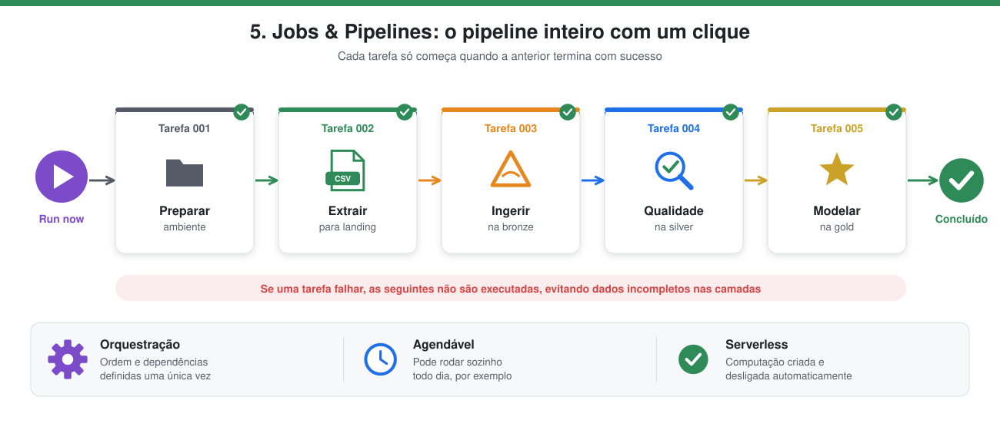
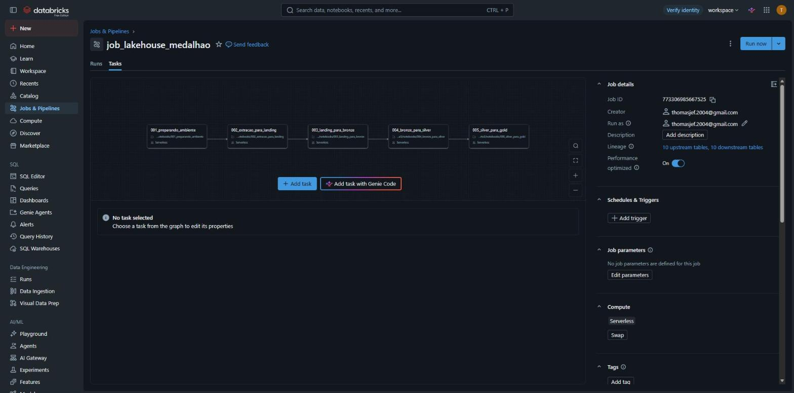
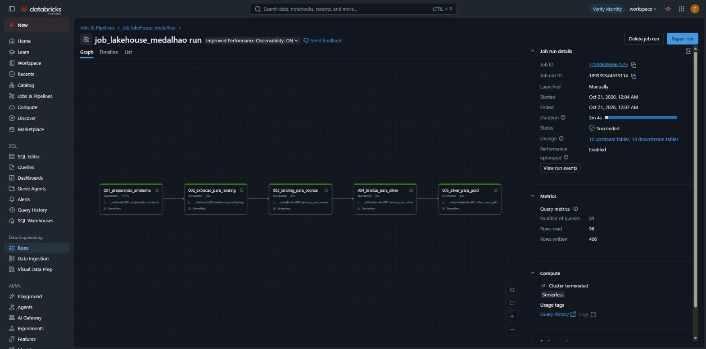

# 5. Jobs & Pipelines



> **Em poucas palavras:** em vez de abrir e rodar cada notebook manualmente, o Job funciona como uma linha de produção: aperta-se **um botão** e ele executa todas as etapas na ordem certa. Se alguma etapa der erro, as seguintes não rodam, para não gerar dados incompletos.

| Condição | O que significa |
|---|---|
| Execuções **encadeadas** em uma JOB | Os 5 notebooks são tarefas de um único Job (`job_lakehouse_medalhao`). |
| Cada etapa executada **sequencialmente** | Cada tarefa depende da anterior (`depends_on`): 001 → 002 → 003 → 004 → 005. |

## O que é um Job
**Jobs & Pipelines** é o orquestrador do Databricks. Um **Job** reúne várias **tarefas** (aqui, notebooks) e define a ordem e as dependências entre elas. Assim o pipeline inteiro roda com um clique, ou por agendamento, sem executar notebook por notebook, e uma etapa só começa se a anterior terminar com sucesso.

## O Job `job_lakehouse_medalhao`
Cada tarefa depende da anterior (`depends_on`), formando a sequência da arquitetura medalhão:

```
001_preparando_ambiente → 002_extracao_para_landing → 003_landing_para_bronze → 004_bronze_para_silver → 005_silver_para_gold
```

| Tarefa | Notebook | Etapa |
|---|---|---|
| 1 | `001_preparando_ambiente` | Schemas e volume |
| 2 | `002_extracao_para_landing` | Extração do PostgreSQL externo → LANDING/DADOS (CSV) |
| 3 | `003_landing_para_bronze` | Ingestão → BRONZE (Delta) |
| 4 | `004_bronze_para_silver` | Data Quality → SILVER |
| 5 | `005_silver_para_gold` | Modelagem dimensional → GOLD |

Todas as tarefas usam computação **serverless**. A definição do Job está em `resources/job_medalhao.json` e pode ser recriada em *Jobs & Pipelines → Create job → Edit as JSON*. O notebook `006_destruindo_ambiente` fica fora do Job, pois só serve para limpar o ambiente.

Os dados de conexão do banco externo são **parâmetros do Job** (`pg_host`, `pg_port`, `pg_database`, `pg_user`, `pg_password`, `pg_schema`). No JSON versionado a senha é só um marcador; o valor real é preenchido no Databricks.



## Execução
Execução completa com sucesso: as 5 tarefas em sequência, em cerca de 3 minutos.

| Tarefa | Status | Duração |
|---|---|---|
| 001_preparando_ambiente | Succeeded | 1m 5s |
| 002_extracao_para_landing | Succeeded | 16s |
| 003_landing_para_bronze | Succeeded | 27s |
| 004_bronze_para_silver | Succeeded | 26s |
| 005_silver_para_gold | Succeeded | 45s |



## Resultado no catálogo
Depois da execução, o catálogo `workspace` contém os schemas `landing`, `bronze`, `silver` e `gold` (a origem fica fora do Databricks):


