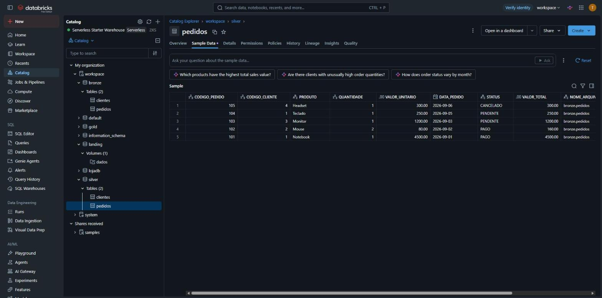

# 3. Data Quality → SILVER

Notebook: `004_bronze_para_silver`

## O que é a camada silver
A **silver** contém os dados **confiáveis**: limpos, padronizados, tipados e validados. É a camada que serve de base para a modelagem dimensional; qualquer problema de qualidade deve ser resolvido aqui, e não na gold.

## Regras de Data Quality aplicadas

| Regra | O que faz | Exemplo |
|---|---|---|
| Nomenclatura | Colunas em maiúsculas e sem siglas | `id_cliente` → `CODIGO_CLIENTE`, `uf` → `UNIDADE_FEDERATIVA` |
| Limpeza de texto | Remove espaços das pontas; nomes, cidades e produtos com iniciais maiúsculas; UF e status em maiúsculas | `' mouse '` → `Mouse` |
| Tipagem | Corrige os tipos perdidos no CSV | `VALOR_UNITARIO` → `decimal(10,2)`, `DATA_PEDIDO` → `date` |
| Duplicidade | Remove registros repetidos pela chave | `dropDuplicates(["CODIGO_PEDIDO"])` |
| Regras de negócio | Descarta quantidade ou valor menores ou iguais a zero e calcula o total do pedido | `VALOR_TOTAL = QUANTIDADE × VALOR_UNITARIO` |
| Auditoria | Troca os metadados da bronze pelos da silver | `NOME_ARQUIVO_BRONZE`, `DATA_ARQUIVO_SILVER` |

## Como funciona
As regras de nomenclatura e auditoria seguem as funções do notebook modelo do professor (`_apply_name_rules` e `_safe_drop`):

```python
def _apply_name_rules(colname: str) -> str:
    """Regras de renome: upper + prefixos 'ID_' e sufixo '_UF'."""
    n = colname.upper()
    n = n.replace("ID_", "CODIGO_")
    if n == "UF":
        n = "UNIDADE_FEDERATIVA"
    return n
```

Para os pedidos, as regras de limpeza, tipagem e negócio:

```python
df_pedidos = (df_pedidos
    .withColumn("PRODUTO", F.initcap(F.trim("PRODUTO")))
    .withColumn("STATUS", F.upper(F.trim("STATUS")))
    .withColumn("DATA_PEDIDO", F.to_date("DATA_PEDIDO"))
    .withColumn("VALOR_UNITARIO", F.col("VALOR_UNITARIO").cast("decimal(10,2)"))
    .filter((F.col("QUANTIDADE") > 0) & (F.col("VALOR_UNITARIO") > 0))
    .dropDuplicates(["CODIGO_PEDIDO"])
    .withColumn("VALOR_TOTAL", (F.col("QUANTIDADE") * F.col("VALOR_UNITARIO")).cast("decimal(12,2)")))
```

## Resultado – `silver.pedidos`

| CODIGO_PEDIDO | CODIGO_CLIENTE | PRODUTO | QUANTIDADE | VALOR_UNITARIO | DATA_PEDIDO | STATUS | VALOR_TOTAL |
|---|---|---|---|---|---|---|---|
| 101 | 1 | Notebook | 1 | 4500.00 | 2026-09-01 | PAGO | 4500.00 |
| 102 | 2 | Mouse | 2 | 80.00 | 2026-09-02 | PAGO | 160.00 |
| 103 | 3 | Monitor | 1 | 1200.00 | 2026-09-03 | PENDENTE | 1200.00 |
| 104 | 1 | Teclado | 1 | 250.00 | 2026-09-05 | PENDENTE | 250.00 |
| 105 | 4 | Headset | 1 | 300.00 | 2026-09-06 | CANCELADO | 300.00 |

## Resultado – `silver.clientes`

| CODIGO_CLIENTE | NOME | CIDADE | UNIDADE_FEDERATIVA |
|---|---|---|---|
| 1 | Ana Souza | Criciúma | SC |
| 2 | Bruno Lima | Florianópolis | SC |
| 3 | Carla Dias | Porto Alegre | RS |
| 4 | Diego Melo | Curitiba | PR |


